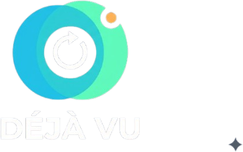
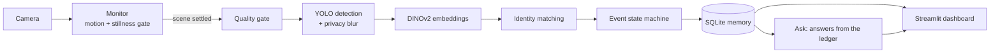

# 👁️ Déjà Vu

**A camera with a memory.** Déjà Vu watches a fixed scene, notices what changed, answers *"where did it go?"* with photographic evidence, and says **"not sure"** instead of guessing.

<!--
After you add assets/logo.png, replace the title line above with:
<p align="center"></p>
-->

[](https://github.com/arooshdatta/dejavu/actions/workflows/ci.yml)


Built by **Code Poachers** for the IEEE Hackathon 2026, Track 03 (Gen AI & ML), category 03.1 *Vision in the Wild*.

---

## Why

In labs, workshops, shops and classrooms, things get moved, borrowed or left out, and nobody knows when. Today people rely on memory, checklists, or scrubbing through hours of CCTV. Simple motion alerts fire on every shadow and lamp flicker, so people stop trusting them.

Déjà Vu turns a plain webcam into a **queryable memory of a space**: what was where, when it changed, and how sure the system is.

## Features

- **Automatic capture:** watches the camera and analyzes a snapshot once the scene has been *still* for a set time after a change. No button pressing.
- **Object memory:** every tracked object gets an identity, a status and a history, stored in a SQLite database.
- **ML identity matching:** DINOv2 appearance embeddings, combined with position, size and colour, tell similar objects apart (falls back to colour matching if the model is unavailable).
- **Event ledger:** `added`, `removed`, `moved` and `returned` events with before/after evidence images and a confidence.
- **Ask in plain language:** *"Where did the bottle go?"*, *"What is missing?"*. Answers come from the saved ledger, never invented, and include images.
- **Honest abstention:** if the camera was covered, the image was too dark or blurry, or a person stood in front of an object, it answers *"not sure"* and explains why instead of guessing.
- **Privacy by design:** people are detected and blurred **before** any image is stored. Everything runs locally.
- **Human feedback:** ✅ / ❌ buttons on every event feed a live precision figure on the Data tab.
- **Data export:** objects, events and snapshots as tables, with CSV download.

## How it works



1. **Monitor:** a background thread compares each frame with one from about half a second earlier. When motion stops for N seconds, it triggers an analysis. If an object looks missing, it takes a confirmation shot a couple of seconds later by itself.
2. **Quality gate:** blurry, too-dark or too-bright snapshots are rejected and never change the memory.
3. **Detection:** YOLO finds objects from a whitelist of desk items. People are detected, then blurred before the image is saved.
4. **Identity:** each detection is matched to a known object with the Hungarian algorithm, using a cost built from appearance, position, size and colour.
5. **Events:** a small state machine turns matches (and non-matches) into events, and marks objects `unknown` rather than `removed` when something may have blocked the view.
6. **Ask:** a rule-based parser finds the object in your question and answers from the ledger.

Details: [docs/ARCHITECTURE.md](docs/ARCHITECTURE.md).

<!--
## Screenshots
Add your screenshots to docs/images/ with these names, then delete the comment markers around this block.

| Live view | Timeline |
|---|---|
|  |  |

| Ask | Data |
|---|---|
|  |  |
-->

## Quick start

**Requirements:** Python 3.10 or newer, a webcam, and an internet connection for the first run (model downloads).

**Windows (PowerShell)**

```powershell
git clone https://github.com/arooshdatta/dejavu.git
cd dejavu
python -m venv .venv
.venv\Scripts\Activate.ps1
pip install -r requirements.txt
streamlit run app.py
```

**macOS / Linux**

```bash
git clone https://github.com/arooshdatta/dejavu.git
cd dejavu
python3 -m venv .venv
source .venv/bin/activate
pip install -r requirements.txt
streamlit run app.py
```

The app opens at <http://localhost:8501>. The first analysis downloads the detector and the embedding model, so it takes longer once.

If PowerShell refuses to activate the environment, run `Set-ExecutionPolicy -Scope Process -ExecutionPolicy Bypass` first.

## Using it

1. Press **Start monitoring** in the sidebar. Close other apps that use the webcam (Zoom, Teams, and so on).
2. Keep the scene still for a few seconds. Déjà Vu takes the **baseline** by itself.
3. Move, remove or add an object, then keep still. A toast notification appears when the change is recorded.
4. Open **Ask** and try *"Where did the bottle go?"* or *"What is missing?"*.
5. Mark events ✅ or ❌ on the **Timeline**. The **Data** tab turns your verdicts into a precision figure.

No server camera? Use the **Manual capture** panel on the Live tab to upload photos instead.

### Statuses and events

| Status | Meaning |
|---|---|
| `present` | Seen in the latest good snapshot |
| `moved` | Seen, but in a different zone than before |
| `missing` | Not seen in the latest snapshot; waiting for confirmation |
| `removed` | Not seen in enough consecutive snapshots (default 2) |
| `unknown` | Not seen, but a person was covering its last position, so no claim is made |

Events: `added`, `removed`, `moved`, `returned`. Positions are reported as a 3×3 grid of zones (for example `top-left`, `center`).

## Settings (sidebar)

| Setting | Default | What it does |
|---|---|---|
| Camera | `0` | `0` built-in webcam, `1` second camera, or an IP-camera URL / video file path |
| Capture after stillness | 3 s | How long the scene must stay still before a snapshot is analyzed |
| Motion threshold | 3.0 | Higher means it needs bigger movement to count as motion |
| Model | `yolov8s.pt` | Detector size: `n` fastest, `m` most accurate |
| Detection confidence | 0.45 | Higher means fewer wrong labels, but may miss real objects |
| Objects to track | desk whitelist | Anything else the detector reports is ignored |
| AI appearance embeddings | on | DINOv2 fingerprints for identity matching |
| Match tolerance | 0.60 | Higher is more tolerant when deciding two sightings are the same object |
| Captures to confirm removed | 2 | Fewer means faster alerts, but more false alarms |

## Project structure

```
dejavu/
├── app.py               Streamlit dashboard (Live, Objects, Timeline, Ask, Data)
├── engine.py            Detection, embeddings, identity matching, events, Ask
├── monitor.py           Background camera thread: motion + stillness trigger
├── store.py             SQLite storage (objects, events, snapshots)
├── requirements.txt     Runtime dependencies
├── requirements-dev.txt Runtime + test dependencies
├── .streamlit/          Dark theme configuration
├── assets/              Logo and static images
├── docs/                Architecture, evaluation protocol, demo script
├── tests/               Pytest suite (no camera or ML models needed)
└── data/                Created at runtime (database, snapshots); git-ignored
```

## Tech stack

| Layer | Tools |
|---|---|
| Detection | Ultralytics YOLOv8 (pretrained, COCO classes) |
| Appearance embeddings | DINOv2-small via Hugging Face Transformers + PyTorch |
| Matching | SciPy (Hungarian algorithm), OpenCV (colour histograms, motion) |
| Storage | SQLite (standard library) |
| UI | Streamlit |
| Tests / CI | Pytest, GitHub Actions |

## Privacy

- People are detected and blurred **before** a snapshot is written to disk.
- All processing is local. No images are sent to any service.
- Memory lives in the `data/` folder and can be wiped with **Reset all memory**.
- Even so, point the camera at objects, not at people, and tell anyone in the space it is running.

## Limitations (please read)

- **Fixed camera only.** A moved camera breaks the zone and position logic.
- **Closed object list.** It only recognizes the whitelisted common object types. Custom objects need an open-vocabulary detector (see the roadmap).
- **Identical objects** can be confused with each other. The system reports ambiguity rather than pretending otherwise.
- **Occlusion** produces `unknown`, not an answer. Small objects and heavy clutter are hard.
- **Confidence is heuristic.** It is derived from the matching cost, not a calibrated probability.
- **Ask is rule-based.** It understands simple questions about objects and recent changes, not arbitrary language.
- **Demo scale.** One camera, one user, a local SQLite file, and no authentication.
- The built-in label alias `skateboard → cell phone` in `engine.py` is a calibration for our demo phone. Remove it if you use other objects.

## Evaluation

The protocol for measuring precision, false triggers and robustness is in [docs/EVALUATION.md](docs/EVALUATION.md). **No results are claimed in this README**; the results table in that file is filled in only from recorded runs.

## Tests

```bash
pip install -r requirements-dev.txt
pytest -q
```

The tests use a scripted fake detector, run in a temporary folder, and need no camera or ML models. They cover baseline, removal confirmation, moves, label filtering, occlusion, rejected snapshots, privacy blurring, Ask answers, embeddings and database persistence.

## Roadmap

- [ ] Open-vocabulary detection, so users can track custom objects
- [ ] Vision-language model to describe *what* changed in plain words
- [ ] Calibrated confidence and a published evaluation
- [ ] Multi-camera support and an edge deployment
- [ ] Hosted backend (container, Postgres, object storage) and authentication
- [ ] Alerts (email or chat) when a registered object goes missing

## Team

**Code Poachers**

- Your Name, role
- Teammate 1, role
- Teammate 2, role

## License

The code in this repository is released under the [MIT License](LICENSE).

Third-party software keeps its own licenses. In particular, **Ultralytics YOLO is distributed under AGPL-3.0 (with a separate commercial license available)**, so check its terms before using this project commercially. Check the license of each model on its page too (for example DINOv2 on Hugging Face). This is not legal advice.

## Acknowledgements

[Ultralytics](https://github.com/ultralytics/ultralytics), [DINOv2](https://github.com/facebookresearch/dinov2) and [Hugging Face Transformers](https://github.com/huggingface/transformers), [Streamlit](https://streamlit.io), [OpenCV](https://opencv.org), and the IEEE Hackathon 2026 organizers.
